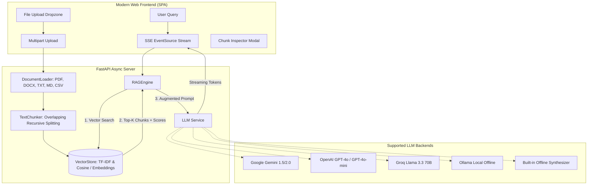

# 🧠 RAG AI Assistant (Without Streamlit)

A modern, high-performance **Retrieval-Augmented Generation (RAG) AI Assistant** built with **FastAPI** backend and a responsive **Single-Page Application (SPA)** web frontend.

Designed from scratch as a replacement for sluggish, full-page reloading Streamlit prototypes, this project delivers real-time token streaming via Server-Sent Events (SSE), interactive document chunk inspection, clickable source citations, and multi-provider LLM support.

---

## 🚀 Why "Without Streamlit"?

| Feature | Typical Streamlit App | This FastAPI RAG Assistant |
| :--- | :--- | :--- |
| **Execution Model** | Entire Python script re-executes on every user click | Async event-driven architecture, zero unnecessary re-runs |
| **Streaming UI** | Clunky reruns, jumpy markdown re-rendering | Silky-smooth Server-Sent Events (SSE) token typewriter |
| **Custom Styling** | Fragile CSS injection hacks | Tailored responsive UI with dark/light themes & Lucide icons |
| **Source Citations** | Basic text strings | Clickable source pills that open exact text chunk modals |
| **Chunk Inspector** | Non-existent or cumbersome expandable trees | Visual chunk inspector showing word counts & token estimates |
| **Production Ready** | Difficult to decouple UI from business logic | Clean REST API with automatic OpenAPI Swagger docs at `/docs` |

---

## 🏗️ Architecture



---

## ✨ Key Features

- **Multi-Format Document Ingestion**:
  - Automatically parses `.pdf`, `.docx`, `.txt`, `.md`, `.csv`, `.json`, and source code files.
- **Recursive Character Chunking**:
  - Configurable chunk size and overlap to preserve semantic context across chunk boundaries.
- **Instant Local Vector Retrieval**:
  - Powered by fast TF-IDF and cosine similarity matrix matching. Works **100% offline with zero API keys or network connection required**!
- **Multi-Provider LLM Integration**:
  - **Google Gemini**: Gemini 1.5 Flash, Gemini 1.5 Pro, Gemini 2.0
  - **OpenAI**: GPT-4o, GPT-4o-mini, GPT-3.5-turbo
  - **Groq**: Llama-3.3-70b-versatile, Llama-3.1-8b-instant
  - **Ollama**: Local models (`llama3`, `mistral`, `deepseek-r1`)
  - **Built-in Offline Synthesizer**: Fallback engine that works without any external account or API cost.
- **Interactive Source Citations**:
  - Displays relevance percentage badges. Click any source to inspect the exact passage and chunk ID.
- **Visual Chunk Inspector**:
  - View how your documents were parsed, token estimates, and word counts.
- **Session Memory & Export**:
  - Multi-turn conversation memory with one-click export to Markdown.
- **Dark & Light Mode**:
  - Elegant glassmorphism dark theme with quick toggle.

---

## ⚡ Quickstart

### 1. Requirements
Ensure you have Python 3.10+ installed.

### 2. Install Dependencies
```bash
pip install -r requirements.txt
```

### 3. Launch the Application
Run the launcher script:
```bash
python run.py
```
*The script starts the server and automatically opens your web browser to `http://127.0.0.1:8000`.*

Alternatively, start with uvicorn directly:
```bash
uvicorn app:app --reload --port 8000
```

---

## ⚙️ Configuration & API Keys

You can configure the application either:
1. **Directly via the Web UI**: Click the **⚙️ Settings** icon in the top header. You can change the active provider, enter API keys, modify chunk sizes, and adjust system prompts on the fly.
2. **Via `.env` file**: Copy `.env.example` to `.env` and fill in your keys:

```env
LLM_PROVIDER=gemini
MODEL_NAME=gemini-1.5-flash
GEMINI_API_KEY=your_gemini_api_key_here
```

---

## 📡 REST API Endpoints

FastAPI provides interactive Swagger documentation accessible at **`http://127.0.0.1:8000/docs`**.

| Method | Endpoint | Description |
| :--- | :--- | :--- |
| `GET` | `/` | Serves the Single-Page Application interface |
| `GET` | `/api/status` | Current server stats, active model, and vector chunk counts |
| `POST` | `/api/upload` | Upload and index multiple documents (`multipart/form-data`) |
| `POST` | `/api/load-sample` | Automatically indexes sample knowledge documents |
| `GET` | `/api/documents` | Lists all indexed documents with metadata |
| `DELETE`| `/api/documents/{name}` | Deletes a document and its chunks from the vector store |
| `GET` | `/api/chunks/{name}` | Returns chunk details for inspection |
| `GET` | `/api/stream` | Server-Sent Events (SSE) streaming chat endpoint |
| `POST` | `/api/chat` | Non-streaming standard JSON chat response |
| `POST` | `/api/config` | Updates runtime LLM settings, API keys, and chunking sizes |
| `GET` | `/api/session/{id}/export` | Exports conversation history as clean Markdown |

---

## 📁 Project Structure

```
RAG AI Assistant/
├── app.py                      # FastAPI application & REST endpoints
├── config.py                   # Pydantic configuration & env management
├── run.py                      # 1-click launch script with browser opener
├── requirements.txt            # Python dependencies
├── .env.example                # Example environment configuration
├── core/
│   ├── __init__.py
│   ├── document_loader.py      # Extract text from PDF, DOCX, TXT, MD, CSV
│   ├── chunker.py              # Recursive character chunker with overlap
│   ├── vector_store.py         # TF-IDF & Cosine vector index with persistence
│   ├── rag_engine.py           # Retrieval, prompt assembly, and orchestration
│   ├── llm_service.py          # Unified streaming connector (Gemini, OpenAI, Groq, Ollama)
│   └── memory.py               # Conversation history and markdown export
├── static/
│   ├── index.html              # Modern ChatGPT/Perplexity-style UI
│   ├── css/
│   │   └── style.css           # Glassmorphism dark/light mode styles
│   └── js/
│       └── app.js              # SSE streaming, citations, chunk inspector
├── uploads/                    # Folder for user uploaded documents
├── data/                       # Persistent vector index storage
└── sample_documents/           # Sample knowledge documents for instant testing
```

---

## 🛡️ License
MIT License. Free for commercial and personal use.
